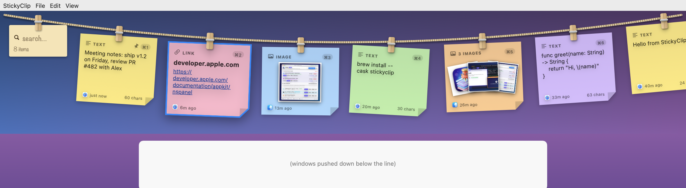
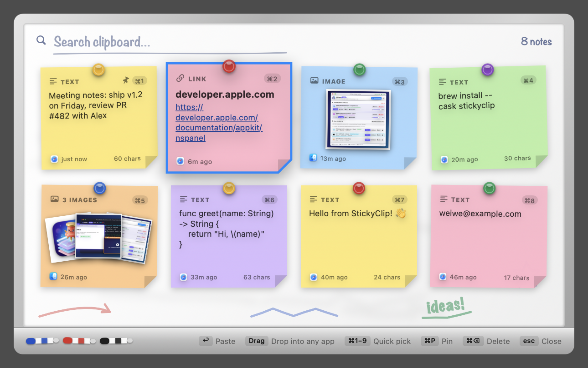
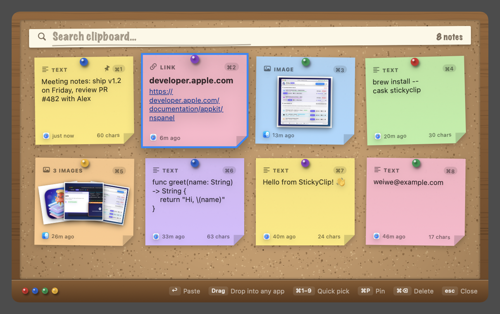
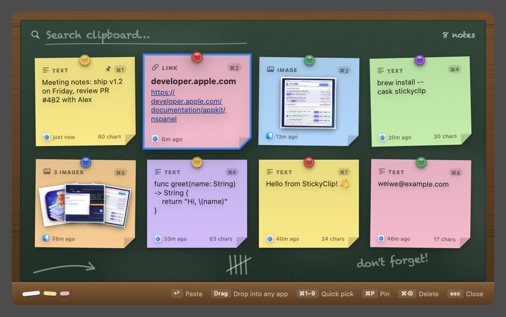

# StickyClip

A tiny macOS menu-bar clipboard manager. Press **⇧⌘V** and your clipboard history drops down from the menu bar as colourful sticky notes hanging on a clothesline. Preview, pick one, and it's pasted into the app you were using.

🌐 **Website:** [stickyclip-app.web.app](https://stickyclip-app.web.app) · ⬇️ [Download the latest release](https://github.com/windmaple/StickyClip/releases/latest)



Prefer a board? Switch under *Style* in the menu bar:



| Cork board | Chalkboard |
| --- | --- |
|  |  |

## Features

- Lives in the menu bar only (no Dock icon)
- Records **text, links, images and Finder files**, with real thumbnails for images, PDFs and videos
- **⇧⌘V** opens the picker without stealing focus from your current app
- **Clothesline** (default): a rope hooked to both ends of the menu bar; notes hang on clothespins, swing in, and slide along the line (← → or scroll). Windows in the way **slide down to make room** and slide back when you're done
- **Board styles**: whiteboard (magnets and markers), cork board (pushpins), chalkboard (chalk), or plain frosted glass
- Search by typing, pick with ↩ or ⌘1–9
- **Drag a note onto any app window** to drop it in. Apps that accept drops insert it where you let go; for windows that don't, StickyClip brings the window forward and pastes with ⌘V
- **Pin** notes so they never get pushed out of history
- Same content copied again just moves to the top (no duplicates)
- Skips password-manager content (respects the `org.nspasteboard.ConcealedType` / `TransientType` markers)
- History is kept between launches in `~/Library/Application Support/StickyClip/`
- Menu bar options: recent items, style (and window shifting on/off), auto-paste on/off, pause recording, history size, launch at login, clear history

## Build & run

Requires macOS 14+ and the Xcode command-line tools.

```bash
./build_app.sh
open StickyClip.app
```

To keep it installed, copy `StickyClip.app` to `/Applications`, then turn on **Launch at Login** from the menu bar icon.

## Permissions

### Accessibility (`System Settings → Privacy & Security → Accessibility`)

StickyClip asks for **Accessibility** permission on first launch (or via **Grant Accessibility Permission…** in the menu bar menu). It is used for three features:

- **Auto-paste**: Sends `⌘V` to the app you were using after you pick a note.
- **Window shifting (Clothesline mode)**: Temporarily slides top-of-screen windows down so they aren't covered by hanging notes, then slides them back when the clothesline closes.
- **Drag-to-paste fallback**: Raises and focuses the window under the cursor when you drop a note onto an app that doesn't natively accept drag-and-drop, then pastes into it.

Without Accessibility permission, StickyClip still works—picking a note copies it to the clipboard so you can press `⌘V` yourself.

> **Rebuilds & local signing:** `build_app.sh` signs the app with a local self-signed certificate (created once by `setup_signing.sh` in `~/Library/Keychains/stickyclip-signing.keychain-db`). That keeps the app's code-signing identity stable across rebuilds so macOS doesn't ask you to re-toggle Accessibility every time you recompile.

### Data from Other Apps & Files and Folders

Because StickyClip monitors the system clipboard and generates live Quick Look thumbnails (`QLThumbnailGenerator`) for copied files, macOS may prompt:

- **“StickyClip” would like to access data from other apps**: Shown when you copy content or file references whose underlying files live inside another app's sandbox container (for example, an image or attachment copied from Messages, Mail, or a third-party app) and StickyClip reads the pasteboard item or renders its thumbnail preview.
- **Files & Folders (`Desktop`, `Documents`, `Downloads`)**: Shown the first time you copy a file from a protected folder in Finder so StickyClip can read its metadata and render a thumbnail on the sticky note.

### Login Items (`System Settings → General → Login Items`)

Turning on **Launch at Login** from the menu bar icon registers StickyClip with `SMAppService`. macOS will display a background/login-item notification the first time you enable it.

### First Launch from GitHub Releases (Gatekeeper)

Release builds are not notarized with an Apple Developer ID certificate. If macOS blocks the app on first launch:

1. Right-click (or Control-click) `StickyClip.app` → **Open**, or click **Open Anyway** in **System Settings → Privacy & Security**, or
2. Clear the quarantine attribute in Terminal:
   ```bash
   xattr -dr com.apple.quarantine /Applications/StickyClip.app
   ```

### What StickyClip *doesn't* ask for

- **No Screen Recording permission**: Window positions are read via `CGWindowListCopyWindowInfo` bounds only—screen pixels are never captured.
- **No Network access**: Clipboard history stays strictly on disk in `~/Library/Application Support/StickyClip/`.

## Keyboard shortcuts (on the board)

| Key | Action |
| --- | --- |
| ⇧⌘V | Show / hide the board |
| ← ↑ ↓ → / Tab | Move the selection |
| ↩ | Paste the selected note |
| ⇧↩ | Copy only (don't paste) |
| ⌘1 … ⌘9 | Paste note 1–9 straight away |
| ⌘P | Pin / unpin |
| ⌘⌫ | Delete note |
| Type | Search |
| Esc | Clear the search, or close the board |

Clicking a note pastes it, right-clicking opens more options, and clicking outside the board closes it.
Drag a note out of the board and the board fades away so you can drop it onto any window. Press Esc mid-drag, or drop on
empty desktop, to cancel.

## Project layout

```
Sources/StickyClip/
  main.swift                  App entry (accessory / menu-bar app)
  AppDelegate.swift           Status item menu, settings, wiring
  HotKeyManager.swift         Global ⇧⌘V via Carbon RegisterEventHotKey
  ClipboardMonitor.swift      Polls NSPasteboard.changeCount and captures new content
  ClipboardStore.swift        History, dedupe, pinning, persistence
  ClipItem.swift              Model + sticky-note palette
  PasteService.swift          Accessibility check + synthetic ⌘V
  NotesPanelController.swift  Non-activating floating panel + keyboard handling
  NotesBoardView.swift        Board UI (search, grid, footer hints)
  StickyNoteView.swift        A single sticky note
  FilePreviewView.swift       Quick Look thumbnails for file/image notes
  BoardTheme.swift            Board styles: surfaces, frames, tray, pins & magnets
  NoteDragSupport.swift       Drag a note out to another app (+ paste fallback)
  ClotheslineView.swift       Clothesline: rope, clothespins, swinging notes, search tag
  WindowShifter.swift         Slides other windows down out of the way and back again
```

For testing, `open StickyClip.app --args --show` opens the board as soon as the app launches.
