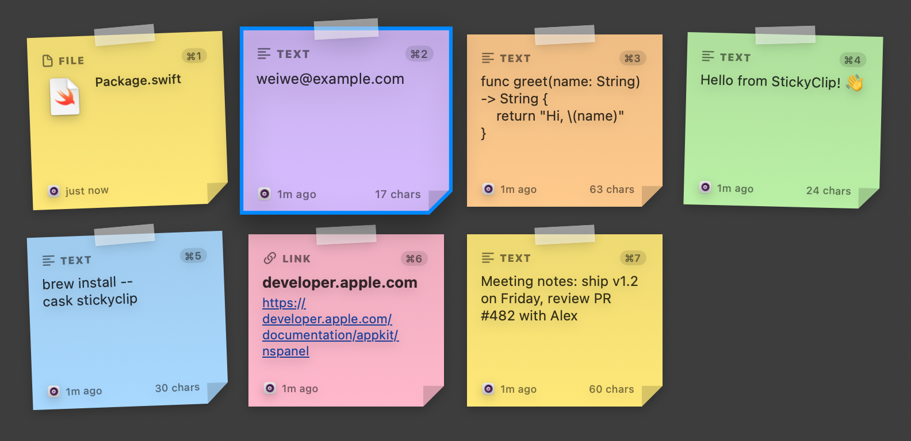
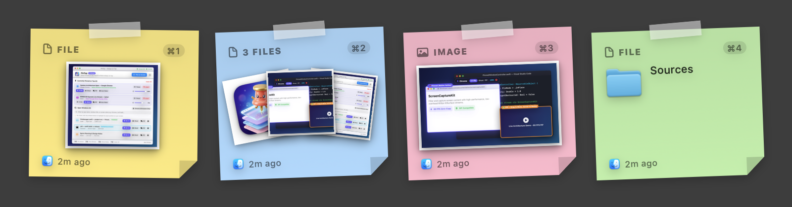

# StickyClip

A tiny macOS menu-bar clipboard manager. Press **⇧⌘V** and your clipboard history pops up as a board of colourful sticky notes — preview, pick one, and it's pasted into the app you were using.





## Features

- Lives in the menu bar only (no Dock icon)
- Records **text, links, images and Finder files**
- **⇧⌘V** opens a floating board of sticky notes (it doesn't steal focus from your current app)
- Search by typing, navigate with arrow keys, pick with ↩ or ⌘1–9
- **Drag a note onto any app window** to drop it in. Apps that accept drops insert it where you let go; for windows that don't, StickyClip brings the window forward and pastes with ⌘V
- **Pin** notes so they never get pushed out of history
- Same content copied again just moves to the top (no duplicates)
- Skips password-manager content (respects the `org.nspasteboard.ConcealedType` / `TransientType` markers)
- History is kept between launches in `~/Library/Application Support/StickyClip/`
- Menu bar options: recent items, auto-paste on/off, pause recording, history size, launch at login, clear history

## Build & run

Requires macOS 14+ and the Xcode command-line tools.

```bash
./build_app.sh
open StickyClip.app
```

To keep it installed, copy `StickyClip.app` to `/Applications`, then turn on **Launch at Login** from the menu bar icon.

### Accessibility permission (for auto-paste)

Picking a note puts it on the clipboard and then sends ⌘V to the app you were using. Sending that keystroke needs
**System Settings → Privacy & Security → Accessibility → StickyClip**. Without it, StickyClip still copies the
note, and you press ⌘V yourself.

> `build_app.sh` signs the app with a local self-signed certificate (created once by `setup_signing.sh` in
> `~/Library/Keychains/stickyclip-signing.keychain-db`). That keeps the app's identity stable, so the
> Accessibility permission survives rebuilds. With ad-hoc signing, macOS would treat every build as a new app.

## Keyboard shortcuts (on the board)

| Key | Action |
| --- | --- |
| ⇧⌘V | Show / hide the board |
| ← ↑ ↓ → / Tab | Move the selection |
| ↩ | Paste the selected note |
| ⇧↩ | Copy only (don't paste) |
| ⌘1 … ⌘9 | Paste note 1–9 straight away |
| ⌘P | Pin / unpin |
| ⌘⌫ | Delete note |
| Type | Search |
| Esc | Clear the search, or close the board |

Clicking a note pastes it, right-clicking opens more options, and clicking outside the board closes it.
Drag a note out of the board and the board fades away so you can drop it onto any window. Press Esc mid-drag, or drop on
empty desktop, to cancel.

## Project layout

```
Sources/StickyClip/
  main.swift                  App entry (accessory / menu-bar app)
  AppDelegate.swift           Status item menu, settings, wiring
  HotKeyManager.swift         Global ⇧⌘V via Carbon RegisterEventHotKey
  ClipboardMonitor.swift      Polls NSPasteboard.changeCount and captures new content
  ClipboardStore.swift        History, dedupe, pinning, persistence
  ClipItem.swift              Model + sticky-note palette
  PasteService.swift          Accessibility check + synthetic ⌘V
  NotesPanelController.swift  Non-activating floating panel + keyboard handling
  NotesBoardView.swift        Board UI (search, grid, footer hints)
  StickyNoteView.swift        A single sticky note
```

For testing, `open StickyClip.app --args --show` opens the board as soon as the app launches.
